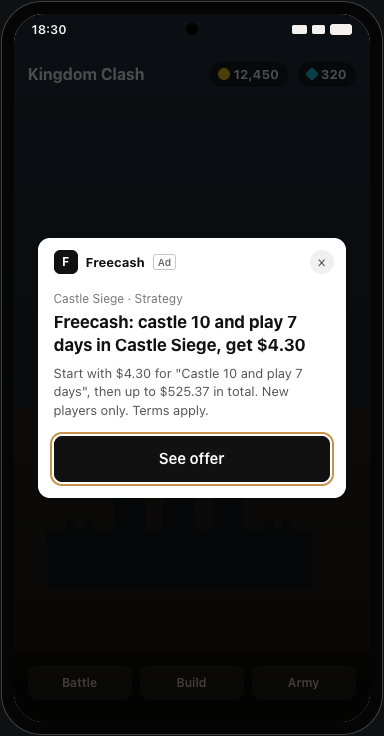
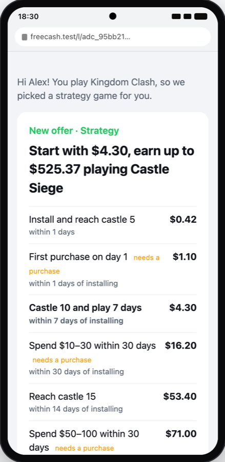
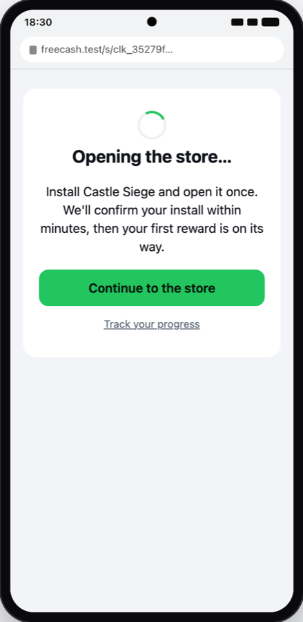
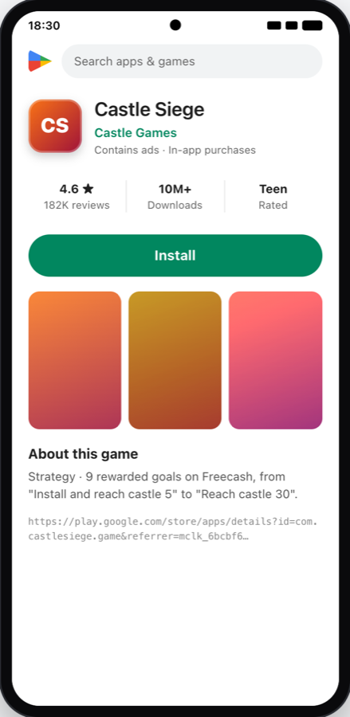
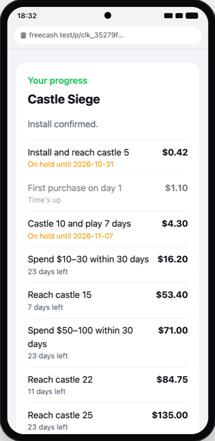

# GameMatch: design

> **In short**
> - About 1 million linked Freecash users have only ever earned through the one game they linked. We show them a Freecash ad inside games they already play, offering a second game.
> - The ad promotes Freecash, not the studio's game. A tap opens a Freecash offer page. On **Start**, our own click ID carries the user's identity to the install and back.
> - Each confirmed goal bills the studio and puts the user's reward on hold for 30 days, in one balanced ledger entry.
> - At US prices, one ordinary offer shown to an average user does not pay for the ads. The only case that might pay is narrow: big past earners, a top-paying offer, US Android.
> - The live test is a 20% holdout on a capped $5,000 budget, with one yes/no rule written before it starts.

## 1. What is the problem, and what is our bet?

Freecash pays users for reaching goals in mobile games. The game studio (the **advertiser**) pays Freecash per goal. Freecash passes part of that to the user as a **reward** and keeps the rest, its **margin**. From the brief: about 1 million linked users never started a second offer, about 75% of them have a usable **ad ID** (the phone's advertising identifier: GAID on Android, IDFA on iPhone), and only about 15% of linked users ever start a second game.

**The bet:** ads inside the games these users already play will get enough of them to start a second game that the extra margin pays for the ads.

**Why paid ads (our hypothesis, in one line):** Link's own Offers screen exists only in some games and each studio can switch it off, while paid ads reach the user in any game they play, with Almedia in control of who, how much and when.

## 2. What does the user see?

<p>    </p>

*Screens from the working demo (`bun run journey`), Android: ad, offer page, verifying, store, progress.*

1. **The ad.** A full-screen ad inside a game the user plays. The text depends on how recently they played their linked game: recent players ("hot") see a concrete goal and reward; others see the total they can earn, or "Your Freecash account has a new game for you".
2. **The tap** goes through Freecash's own tracking company and opens `freecash.com/go/<campaign>`. If the Freecash app is installed it opens, logged in. If not, the browser opens our web offer page.
3. **The offer page** explains the reward before anything else: first reward, total, each goal with its reward and deadline, the rules, and one **Start & install** button. Some offers add a **linked-player bonus**: the first easy goal pays double if reached within 48 hours.
4. **Start** records the offer start with a new click ID, then sends the user through the studio's tracking link to the app store.
5. **After install,** each goal reached shows in Freecash as "on hold until …", then "ready to cash out". `bun run journey` prints every screen for one user, next to every message between the parties.

## 3. How do the parts fit together?

Two tracking companies are involved. Each is an **MMP** (mobile measurement partner, such as AppsFlyer or Adjust): it decides which source gets credit for an install. The **studio's MMP** decides whether Freecash earned the install and sends us a **postback** (a message such as "install" or "level 10") for each goal. That is what we bill on. **Freecash's own MMP** records the ad tap and tells the ad network that an offer started, so the network can learn. No money depends on it.

```
 FREECASH (system under test)                        OUTSIDE PARTIES (mocked)
+--------------------------------------------+
| Enrolment: group, segment, tier, platform  |  ad-ID lists  +------------------------+
|  fixed once -> one campaign per offer x    | ------------> | AD NETWORK             |
|  segment x tier; consent, age, country     |               | audiences, auction,    |
|  rechecked at every upload                 | <- daily cost | 2 ads/user/day, cap    |
| Spend sync (+ corrections, pause at $5k)   |               +-----------+------------+
|                                            |                ad shown | tap
| /go/:campaign (app session, else ad ID)    |               +-----------v------------+
|  -> /l/:click offer page                   | <- deep link -| FREECASH'S MMP         |
|  -> Start = click ID (+ 48 h bonus?)       | -- started -> | records tap; tells the |
|  -> /s/:start "opening the store"          |               | network "offer started"|
|        | tracking link + click ID          |               +------------------------+
|        +------------------------------------------------>  +------------------------+
|                                            |               | STUDIO'S MMP           |
| /postbacks/:advertiser  <-------------------- postback --- | last click wins:       |
|  -> LEDGER: bill studio + reward on hold   |               | Android referrer/GAID, |
|       -> released (30 d) or reversed       |               | iOS IDFA if allowed    |
|  -> Readout: profit per treated user,      |               +-----------^------------+
|     install lift, 95% ranges               |                install, goals |
+--------------------------------------------+               +-----------+------------+
                                                             | OFFER GAME             |
                                                             | (store -> play)        |
                                                             +------------------------+
```

Freecash is one Bun server (Elysia, SQLite). Business rules are pure functions; the ad network and the MMP sit behind two small interfaces, so a real one can replace a mock without touching the rules.

**Why the tap goes through Freecash's MMP.** Moloco, *Create a new Campaign (DSP API reference)*: "tracking_link_id is required for APP installs or re-engagement type campaign" ([link](https://developer.moloco.cloud/reference/dspapi_createcampaign-1.md)). So "bring users back to our app" campaigns must use the app's own tracker and open the app. We follow that, with our web page as the fallback.

## 4. How do we know who installed, and who gets credit?

**Before Start.** In the Freecash app, the logged-in session says who the user is. On the web page there is no login, so the ad ID in the tap picks the account. We accept this for the MVP because an install on any other phone is rejected; a web login before Start is the fix.

**From Start on,** our own **click ID** carries identity: we put it in the studio's tracking link, and the studio's MMP returns it in every postback. The ad ID is used only to choose who sees ads, never as proof of who installed.

| | Android | iPhone |
|---|---|---|
| How the studio's MMP matches the install to our click | The Play Install Referrer carries the click ID through the store, so it works even with a zeroed GAID ([Android Developers, *Google Play Install Referrer*](https://developer.android.com/google/play/installreferrer)); otherwise last click by GAID | Last click by IDFA, only if the user allowed tracking in the new game (Apple's ATT prompt). Otherwise there is no user-level postback |
| Share of installs credited to us | 88% (our estimate) | 45% (our estimate). AppsFlyer reports lower tracking opt-in for gaming apps than others, 31% vs 42% ([AppsFlyer](https://www.appsflyer.com/blog/measurement-analytics/att-opt-in-rates-higher/)) |
| Users we can reach with ads in 14 days | 49% of the list (range 37–63%, our estimate) | 18% (range 9–30%, our estimate) |
| What we do | Bid normally | Bid lower, in separate campaigns |

A phone that already had the game is a reinstall: nobody is credited. Most offers pay "new players only", so the offer page says so and the bid counts only eligible users (65%, our estimate).

## 5. Who is paid or billed, and when?

| Party | What happens | When |
|---|---|---|
| **Studio** (advertiser) | Billed the payout for each goal | When its MMP's postback for that goal arrives |
| **User** | Reward recorded **on hold** in the same step | Cashable after 30 days (our choice; Freecash's Terms allow holds up to 90 days, [Freecash Terms](https://freecash.com/en/terms)) |
| **Ad network** | Paid for ads shown (price per 1,000 ads) | Its daily cost is copied into our books each day, including later corrections; all campaigns pause at $5,000 total |
| **Freecash's MMP** | No money depends on it | It only feeds the network's learning |

**Reversals.** During the 30-day hold, a conversion can be reversed only if Almedia rules it Invalid Activity, or we find fraud. A reversal undoes both the bill and the reward with a new, opposite ledger entry. After release, a reversal is refused. Under Almedia's Advertiser Terms, advertisers get no chargebacks for users flagged later; the 5 business days in those terms are a window to dispute an invoice, which Almedia decides outside this system.

**The ledger.** Every money movement has lines that add up to zero, in whole millionths of a dollar. Nothing is edited; corrections are new lines.

## 6. What is an ad worth, and where can it pay?

Terms: **CPM** is the price for 1,000 ads shown. **CTR** is the share of ads tapped. **Incrementality** is the share of installs that happen only because of the ad.

**The formula** (one function shared by the server, `bun run roi` and the dashboard): extra installs per ad = CTR × share who tap Start × share who install × incrementality. Each extra install is worth: share credited × share eligible × margin per credited install. Bid = value × 0.8 (we keep 20%). Later offers count as $0 in the bid and the decision.

**The honest economics** (`bun run roi`; base inputs, all our estimates: CTR 2.5%, Start 30%, install 60%, eligible 65%, incremental 40%; a simple offer with $1.88 margin per credited install):

| | Android | iPhone |
|---|---|---|
| Value of 1,000 ads | $1.93 | $0.99 |
| Highest bid, keeping 20% | $1.54 | $0.79 |
| The same, with the bonus's expected cost | $0.82 | $0.42 |
| Market price per 1,000 ads, US, platform fee included | about $17 | about $21 |
| CTR needed to break even at $15 per 1,000 ads | 19.43% | 37.99% |

The market price is from published rates: GameDev Reports (Tenjin data), *Ad Monetization in Mobile Games in Q2'24*: "The average eCPM for Rewarded Ads in the US was $30.25" on Android ([link](https://gamedevreports.substack.com/p/tenjin-ad-monetization-in-mobile-00b)). We use $17 on Android and $21 on iPhone, with an assumed 25% platform fee. **So a flat bid for one ordinary offer loses money at market prices.**

**Where it can work.** Freecash knows things a normal advertiser does not: who earned a lot through Link, and who played yesterday. Johnson, Lewis & Reiley, *Add More Ads?* (2013): "Customers with high past sales have a $1.74 lift (s.e. $0.93) versus $0.16 (s.e. $0.10) in the rest" ([link](https://www.davidreiley.com/papers/AddMoreAds.pdf)). The best case we found combines three levers:

- **Who:** high value tier (Link earnings of $50 or more), played in the last 14 days, US, Android.
- **What:** a premium offer (about $7.0 margin per credited install; modelled from public offer ladders, not observed).
- **Result** (the dashboard, per 1,000 ads, our estimate):

| Case | Profit per 1,000 ads |
|---|---|
| At $17, as built (played in last 3 days: +$5.45; last 14 days: −$0.10) | **+$2.09** |
| At $15 | +$4.09 |
| Big earners bring 1.2× the margin instead of 1.5× | −$1.73 |
| Every uncertain input at its cautious end | −$27.78 |

This is marginal, and about 10,800 Android users are reachable in 14 days. It works only if big earners really bring about 1.5× the margin of other users. **Almedia can check that from its own records before buying any ads.** Other levers, smaller or later: paying per Start instead of per 1,000 ads (the network carries the tap risk), Link's Offers screen paid as a share of margin, and Europe after a consent flow.

## 7. Which options did we consider?

| Decision | Options | Chosen, and why |
|---|---|---|
| What the ad promotes | The studio's game · Freecash | **Freecash.** The reward needs explaining, and we have no right to advertise another studio's brand. |
| Where the tap lands | Studio's link · our offer page · app deep link | **Offer page behind a deep link.** The studio's link opens only on Start, so we never send fake-looking clicks. |
| Identity | Ad ID end to end · our click ID | **Click ID from Start.** Works with zeroed ad IDs and on iPhone; ad IDs are not secrets. |
| Channel | Network audiences · own bidder · Link Offers screen | **Network audiences** (Moloco, Google) behind one interface. Nothing to build first. |
| Test bid | Value-based · fixed | **Fixed $15 per 1,000 ads, $5,000 cap.** The value-based bid needs the numbers the test measures. |
| Platforms | Android only · both | **Both, separate bids.** iPhone installs are credited less often, so it bids lower. |
| Which offer a user sees | One audience per offer · one plan | **One plan:** each user in one campaign, their best offer by expected margin. Our campaigns never compete. |
| Rewards | Cashable at once · on hold | **On hold 30 days**, to catch fraud before money leaves. |
| Ledger | Balance columns · double-entry | **Double-entry.** Money cannot appear or vanish. |

## 8. How do we test it live?

- **Who:** linked users who never started another offer, 18 or older, in the US, who allow cross-app ads and have a usable ad ID. Consent, age, country and tracking are rechecked at every audience upload.
- **Groups:** 80% see ads, 20% do not (the control). Placement is fixed once by a hash of the user ID, before any ad runs. Users who later drop out stay in their group for the comparison (**intent-to-treat**). AppsFlyer recommends a 15–25% control for this kind of test ([AppsFlyer Help Center](https://support.appsflyer.com/hc/en-us/articles/360014225577)).
- **Ads:** 14 days, at most 2 per user per day, fixed $15 per 1,000 ads, $5,000 total cap. About 36,000 users.
- **Measured:** extra profit per treated user (extra margin over control, minus ad spend), install lift, and the funnel per platform, segment and tier: taps, Starts, installs, credited share.
- **Guardrails at day 7** (pause if): CTR below 0.5%; credited installs per Start below half of what we expect; postbacks from the wrong device above 2%; play in the linked game more than 2% below control.
- **Timeline:** day 44 early look (can only stop); **day 90 decision**; day 120 books check once the last holds have closed.

**The rule:** "We decide at day 90. We continue only if, for all treated users together, the lower end of the 95% confidence range for extra profit per treated user is above zero — counting no follow-on value. Results by segment, value tier or platform are only for learning, not for the decision. The extra installs per treated user (install lift) is the early signal we check first, because it needs far fewer users to see."

The **95% confidence range** is the band the true number very likely lies in. "Lower end above zero" means we are confident the ads make money. Above zero → continue; below zero at the top end → stop; in between → inconclusive, which means do not scale.

**Why install lift first.** Profit per user is noisy: most users earn $0 and a few earn hundreds. Lewis & Rao, *The Unfavorable Economics of Measuring the Returns to Advertising* (2015): "The median confidence interval on return on investment is over 100 percentage points wide" ([link](https://ideas.repec.org/a/oup/qjecon/v130y2015i4p1941-1973.html)). An install is a yes/no per user, so its range is far narrower. At about 36,000 users the test can see a profit of about $0.22 per treated user or more (our calculation); an install lift needs far fewer users.

**What the simulation shows** (it checks the machinery, not the market): `bun run demo` (20,000 users, $15, day 90) spends $929.60. Extra profit per treated user is +$0.27 (range −$0.32 to +$0.87): **inconclusive**. Install lift is +4.01 percentage points (range +2.59 to +5.43): a clear early signal. In 100 simulated tests where ads do nothing, the rule said "continue" 0 times.

## 9. What next?

- **If it succeeds:** switch to value-based bids using the measured rates, tested against a holdout; add offers; connect a real network and MMP; add a web login before Start.
- **If install lift is clear but profit is not:** the ads change behaviour but cost too much. Try cheaper routes to the same effect: Link's Offers screen on a margin share, paying per Start, or a free push message. Then stop paid ads.
- **If install lift is near zero:** the ads do not work for these users. Stop.
- **If inconclusive:** one rerun with a changed bid, offer or ad, chosen from the funnel, then decide.
- **Before any of this:** Almedia checks from its records whether big earners bring about 1.5× the margin of other users. Below 1.2×, the best case does not pay and we drop it.

---

## Appendix A. Assumptions

Each is labelled: **brief**, **published**, **our estimate**, **our choice**, or **needs Almedia's data**.

| Assumption | Value | Label |
|---|---|---|
| Linked users with no second offer | ~1 million | brief |
| Usable ad ID | 75% | brief |
| Linked users who ever start a second game | 15% | brief |
| Android / iPhone split | 66% / 34% | our choice; needs Almedia's data |
| Adults (18+) | 80% | our estimate |
| CTR · Start · install | 2.5% · 30% · 60% | our estimate |
| Installs credited to us | Android 88%, iPhone 45% | our estimate |
| Eligible ("new players only") | 65% | our estimate; needs Almedia's data |
| Incrementality | 40% | our estimate |
| Recent players (last 3 days) respond more | ×1.56 (CTR ×1.25, Start ×1.25) | our estimate, matching the ×1.55 response gap in the public Hillstrom e-mail experiment |
| Big earners bring more margin | ×1.5 | our estimate; needs Almedia's data |
| Genre match bonus when choosing an offer | ×1.15 | our choice |
| Margin per credited install | $1.88 simple offer; ~$7.0 premium | our estimate (modelled from public offer ladders) |
| Price per 1,000 ads, US | ~$17 Android, ~$21 iPhone, fee 25% included | published rates, our estimate of the mix |
| Users reachable in 14 days | Android 49%, iPhone 18% | our estimate |
| Reward hold | 30 days | our choice |
| Linked-player bonus | 2× the first goal within 48 h, only if reachable in 48 h | our choice |
| Value of later offers | $0 in the bid and the decision; ceiling $20 | our choice; our estimate |
| Test budget | $5,000 total | our choice |

## Appendix B. Questions for Almedia

1. Do users with high Link earnings bring more margin on their next offer? This decides the best case.
2. What is the country split of the 1 million linked users? It decides the legal basis and where the test runs.
3. How many linked users have the Freecash app, and how many use only the website? Re-engagement campaigns reach only app users.
4. Settled margin per credited install, after reversals, for the offers we would promote.
5. How many linked users already had each promoted game (eligibility)?
6. How often do linked users start a second offer today without ads, and how does the offer page convert?
7. What is a user who starts a second offer worth over 90 days and 12 months?
8. How many linked users play games that show the Offers screen?
9. Android / iPhone split; where the ad IDs come from; what users agreed to at linking and sign-up.
10. How are iPhone installs credited today when the user did not allow tracking in the offer game?
11. Do advertiser contracts limit paid ads by partners, or require ad approval?
12. Which ad networks will sell re-engagement to Freecash at a fixed price per 1,000 ads, and which only per action?
